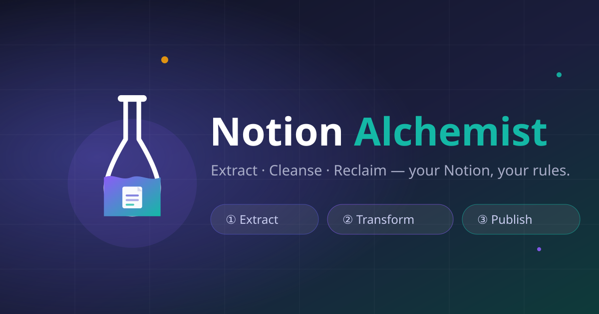
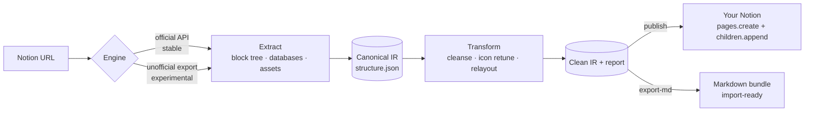

<div align="center">



# Notion Alchemist

**Extract · Cleanse · Rebuild** — turn any Notion page you can access into *your own* knowledge base.

[](LICENSE)
[](https://www.python.org/downloads/)
[](#-use-as-an-agent-skill)
[](CONTRIBUTING.md)

<sub>中文说明见 [README.zh-CN.md](README.zh-CN.md)</sub>

</div>

---

## ✨ What it does

Notion Alchemist is a local-first pipeline with three stages:

1. **Extract** — read an entire Notion page tree (blocks, nested children, databases, images & files) into a canonical, structured archive. The **official Notion API** is the primary engine; an *experimental* unofficial export engine covers view-only pages (e.g. guest access to a paid template library).
2. **Transform** — cleanse the content so it becomes *yours*: strip special markers (synced blocks, template credits, watermark-ish text), retune icons to your own strategy, re-layout (heading hierarchy, auto table-of-contents, list normalisation) and rewrite metadata.
3. **Publish** — rebuild the cleaned tree as fresh pages in **your own Notion workspace** — chunked, rate-limited, resumable and idempotent. Or export a clean, import-ready **Markdown bundle**.

No server. No telemetry. No paid tier. Your credentials never leave your machine.

## 🧭 Why

Notion holds a lot of valuable knowledge — but much of it is locked inside
someone else's private workspace, a paid template library, or a structure you
cannot reorganise.

Notion Alchemist exists to make your Notion content **portable and yours to
restructure**: it reads a page tree you already have access to, cleanses it
into a canonical archive, and rebuilds it — as fresh pages in your own
workspace, or as an import-ready Markdown bundle.

It is a personal knowledge-reorganisation tool: **you bring the access rights,
it hands you a clean, re-publishable archive.** It automates work you could
otherwise do by hand, block by block.

> **Responsible use.** Extract only content you are authorised to access, and
> respect the licences and terms of the source material. This tool does not
> bypass permissions — it automates what you could otherwise do by hand.

## 🏗 How it works



Everything between *Extract* and *Publish* is plain JSON on disk — inspect it,
script it, version it.

## 🚀 Quickstart

```bash
# 1. install
pip install notion-alchemist

# 2. configure (see docs/notion-token-setup.md for the 2-minute token guide)
cp .env.example .env
#   NOTION_TOKEN=secret_...        # integration token
#   NA_PARENT_PAGE=https://...     # parent page in YOUR workspace

# 3. run the whole pipeline
notion-alchemist run "https://www.notion.so/your-source-page" --parent "$NA_PARENT_PAGE"
```

Prefer to look before you leap? Run the pipeline on built-in mock data — no
credentials needed:

```bash
notion-alchemist demo        # writes examples/demo_output/
```

## 🧪 Demo

`notion-alchemist demo` generates a mock source library (nested pages, a
database, callouts, synced blocks, images) and pushes it through all three
stages, producing a transformed archive, a publish plan and a Markdown bundle
under `examples/demo_output/`. Ideal for evaluating the transform rules and
the output shape before touching a real workspace.

A trimmed sample of that output is committed at
[`examples/sample-output/`](examples/sample-output/) — you can judge the
result without installing anything.

## 📸 Sample output

| Before (source) | After (transform) |
|---|---|
| `Second Brain OS` · emoji-laden title, coloured callouts, a template block and a TOC marker | `Second Brain OS` · plain title, default colours, template/TOC stripped, provenance callout appended |

Full before/after: [`examples/sample-output/before-after.md`](examples/sample-output/before-after.md)

## 📖 CLI reference

| Command | Description |
|---|---|
| `na extract <url>` | Fetch a page tree → `output/structure.json` (+ `output/assets/`) |
| `na transform <structure.json>` | Cleanse / retune icons / relayout → `transformed.json` + `transform-report.json` |
| `na publish <transformed.json> --parent <id\|url>` | Rebuild pages in your Notion (chunked, resumable, idempotent) |
| `na publish-feishu <transformed.json> [--folder <token>]` | Copy the IR into Feishu/Lark Docs as docx documents |
| `na run <url> --parent <id\|url>` | extract → transform → publish in one shot |
| `na export-md <transformed.json>` | Produce an import-ready Markdown bundle |
| `na demo` | Full pipeline on mock data, no credentials |
| `na doctor` | Validate configuration and token shape |

Common options: `--engine api|export|auto` (use `export` for view-only
pages) · `--icon-mode keep|retune|none` · `--no-assets` · `--dry-run` ·
`--md-only` · `-v`. Full surface: [references/cli-reference.md](references/cli-reference.md).

## ⚙️ Configuration

Configuration comes from environment variables or a `.env` file:

| Variable | Required | Meaning |
|---|---|---|
| `NOTION_TOKEN` | for `api` engine | Internal integration token |
| `NOTION_TOKEN_V2` | for `unofficial` engine | `token_v2` cookie (**experimental** — treat as your password) |
| `NA_PARENT_PAGE` | for `publish` | Target parent page ID or URL |
| `NA_FEISHU_APP_ID` | for `publish-feishu` | Feishu custom app id (`cli_…`) |
| `NA_FEISHU_APP_SECRET` | for `publish-feishu` | Feishu custom app secret |
| `NA_FEISHU_FOLDER` | no | Folder token to create documents in |
| `NA_FEISHU_BASE` | no | `https://open.feishu.cn` (Feishu) or `https://open.larksuite.com` (Lark) |
| `NA_ICON_MODE` | no | `keep` \| `retune` (default) \| `none` |
| `NA_MAX_RPS` | no | Write rate limit, default `2.5` |
| `NA_HTTP_TIMEOUT` | no | Per-request timeout, default `30` |
| `NA_LOG_LEVEL` | no | `DEBUG` \| `INFO` \| `WARNING` |

The writer is deliberately conservative: ≤100 blocks per request, sequential
appends, `Retry-After` honoured on `429`, and `503` responses interpreted via
Notion's `retry_guidance` so a successful-but-ambiguous write is never blindly
replayed. Progress is tracked in `.na_state.json`, so an interrupted publish
resumes exactly where it stopped.

## 🤖 Use as an Agent Skill

The repository root **is** an Agent Skill (`SKILL.md`, plus `scripts/`,
`references/`, `assets/`) and works with any skills-compatible agent:

```bash
# Claude Code / WorkBuddy style
git clone https://github.com/yuhao-xin/notion-alchemist.git ~/.claude/skills/notion-alchemist
# then simply ask: "extract this Notion page into my workspace: <url>"
```

The skill instructs the agent to run the CLI, never to improvise API calls.

## 📚 Documentation

Language: **en** = English, **zh** = 中文. See [docs/index.md](docs/index.md) for the
annotated index.

| Doc | Lang | Contents |
|---|---|---|
| [docs/notion-token-setup.md](docs/notion-token-setup.md) | zh | **Start here** — credential tutorial, step by step, ~5 min |
| [docs/notion-token-setup.en.md](docs/notion-token-setup.en.md) | en | Same tutorial in English |
| [docs/feishu-publish.md](docs/feishu-publish.md) | zh | Publish to Feishu/Lark Docs — app setup, scopes, behaviour |
| [docs/feishu-publish.en.md](docs/feishu-publish.en.md) | en | Same tutorial in English |
| [docs/architecture.md](docs/architecture.md) | zh | IR shape, both engines, the write-back strategy and why |
| [docs/architecture.en.md](docs/architecture.en.md) | en | Same, in English |
| [docs/transform-rules.md](docs/transform-rules.md) | zh | every transform rule with before/after examples |
| [docs/faq.md](docs/faq.md) | zh | common problems, error codes, copyright stance |
| [docs/pm-review.md](docs/pm-review.md) | zh | product review + SkillHub rubric cross-check |
| [references/cli-reference.md](references/cli-reference.md) | en | full CLI surface, generated from `--help` |
| [docs/github-upload.md](docs/github-upload.md) | zh | push this repo to GitHub, step by step |

## 🐳 Docker

```bash
docker build -t notion-alchemist .
docker compose run --rm alchemist run "<notion-url>" --parent "$NA_PARENT_PAGE"
```

Mount `./output` for results; the state file is mounted for resumable runs.
Scheduled (re-)publication can be driven by host cron or GitHub Actions.

## 🗺 Roadmap

- **v0.2** — unofficial *duplicate* engine (in-place clone via saveTransactions)
- **v0.3** — incremental sync & diff between source and published copy
- **v0.4** — optional local web UI for previewing the transform before publish

## 🤝 Contributing

See [CONTRIBUTING.md](CONTRIBUTING.md). Bug reports and feature requests via
[issues](https://github.com/yuhao-xin/notion-alchemist/issues).

## 📄 License

[MIT](LICENSE) © 2026 Notion Alchemist Contributors
