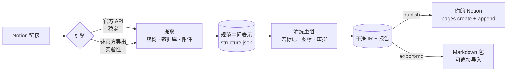

<div align="center">


# Notion Alchemist · 概念炼金术士

**提取 · 清洗 ·  reclaim** —— 把任何你有权访问的 Notion 页面，变成**你自己的**知识库。

[](LICENSE)
[](https://www.python.org/downloads/)
[](#-%E4%BD%9C%E4%B8%BA-agent-skill-%E4%BD%BF%E7%94%A8)
[](CONTRIBUTING.md)

<sub>English version: [README.md](README.md)</sub>

</div>

---

## ✨ 它做什么

一个本地优先的三段式流水线：

1. **提取（Extract）**——把整棵 Notion 页面树（块、嵌套子块、数据库、图片与文件）读成规范化的结构化归档。主引擎走**官方 Notion API**；另有一个**实验性**非官方导出引擎，覆盖「只能看、不能给集成授权」的页面（例如以访客身份浏览的付费模板库）。
2. **清洗重组（Transform）**——把内容变成**你自己的**：去除特殊标记（同步块、模板署名、水印类文本）、按你自己的策略重组图标、重新排版（标题层级规整、自动目录、列表规范化）、改写元数据。
3. **再发布（Publish）**——把清洗后的树在**你自己的 Notion 工作区**重建为新页面：分块写入、限流、断点续跑、幂等。也可以导出干净、可直接导入的 **Markdown 包**。

没有服务端、没有遥测、没有付费档。凭证只在本机。

## 🧭 为什么做

Notion 沉淀了大量有价值的知识，但它们常常锁在别人的私有工作区、付费模板库，
或一个你无法重组的结构里。Notion Alchemist 的初衷是**让知识回归本人**：
*私有 → 你的，付费 → 免费*。它是一个个人知识重组工具——你带来访问权，它还你一个
干净、可再分发的归档。

> **负责任使用。** 仅提取你有权访问的内容，并遵守源材料的许可与条款。
> 本工具不突破权限，只是把「手动能做」的事自动化。

## 🏗 工作原理



提取与发布之间的一切都是磁盘上的 JSON——可检查、可脚本化、可版本化。

## 🚀 快速开始

```bash
# 1. 安装
pip install notion-alchemist

# 2. 配置（Token 两分钟申请教程见 docs/notion-token-setup.md）
cp .env.example .env
#   NOTION_TOKEN=secret_...        # 集成令牌
#   NA_PARENT_PAGE=https://...     # 你自己工作区的父页面

# 3. 一条命令跑完整流水线
notion-alchemist run "https://www.notion.so/你的源页面" --parent "$NA_PARENT_PAGE"
```

想先看看效果？用内置 mock 数据跑通全流程，**无需任何凭证**：

```bash
notion-alchemist demo        # 输出到 examples/demo_output/
```

## 🧪 演示模式

`notion-alchemist demo` 会生成一个模拟源库（嵌套页面、数据库、callout、同步块、
图片），完整走一遍三个阶段，产出清洗后的归档、发布计划与 Markdown 包到
`examples/demo_output/`。适合在接触真实工作区前，先评估清洗规则与输出形态。

## 📖 命令一览

| 命令 | 说明 |
|---|---|
| `na extract <url>` | 抓取页面树 → `output/structure.json`（IR JSON + `output/assets/`） |
| `na transform <structure.json>` | 清洗 / 图标重组 / 重排 → `transformed.json` + `transform-report.json` |
| `na publish <transformed.json> --parent <id\|url>` | 在你的 Notion 重建页面（分块、可续跑、幂等） |
| `na run <url> --parent <id\|url>` | 提取 → 清洗 → 发布 一条龙 |
| `na export-md <transformed.json>` | 生成可直接导入的 Markdown 包 |
| `na demo` | mock 数据全流程，无需凭证 |
| `na doctor` | 校验配置与令牌格式 |

常用选项：`--engine api\|export\|auto`（仅查看权限页面用 export）·
`--icon-mode keep\|retune\|none` · `--no-assets` · `--dry-run` ·
`--md-only` · `-v`。完整参数见 [references/cli-reference.md](references/cli-reference.md)。

## ⚙️ 配置

通过环境变量或 `.env` 文件配置：

| 变量 | 必填 | 含义 |
|---|---|---|
| `NOTION_TOKEN` | `api` 引擎 | 内部集成令牌 |
| `NOTION_TOKEN_V2` | `unofficial` 引擎 | `token_v2` Cookie（**实验性**） |
| `NA_PARENT_PAGE` | `publish` | 目标父页面 ID 或链接 |
| `NA_ICON_MODE` | 否 | `keep` \| `retune`（默认） \| `none` |
| `NA_MAX_RPS` | 否 | 写入限速，默认 `2.5` |
| `NA_HTTP_TIMEOUT` | 否 | 单请求超时，默认 `30` |
| `NA_LOG_LEVEL` | 否 | `DEBUG` \| `INFO` \| `WARNING` |

写入端刻意保守：每请求 ≤100 块、顺序追加、`429` 遵循 `Retry-After`、`503` 按 Notion
的 `retry_guidance` 判断（已成功的写绝不盲目重放）。进度记录在 `.na_state.json`，
中断后可从断点精确续跑。

## 🤖 作为 Agent Skill 使用

仓库根目录**本身就是一个 Agent Skill**（`SKILL.md` + `scripts/` + `references/`
+ `assets/`），可被任何兼容 skills 的 agent 使用：

```bash
git clone https://github.com/YOUR_GITHUB_USERNAME/notion-alchemist.git ~/.claude/skills/notion-alchemist
# 然后直接说：「把这个 Notion 页面提取到我的工作区：<url>」
```

Skill 会指导 agent 调用 CLI，而不是临时拼 API 请求。

## 📚 文档

| 文档 | 内容 |
|---|---|
| [docs/notion-token-setup.md](docs/notion-token-setup.md) | **先看这个** —— 凭证申请教程，一步步约 5 分钟 |
| [docs/architecture.md](docs/architecture.md) | IR 结构、双引擎、写回策略及理由 |
| [docs/transform-rules.md](docs/transform-rules.md) | 每条清洗规则 + 前后对比实例 |
| [docs/faq.md](docs/faq.md) | 常见问题、错误码、版权立场 |
| [references/cli-reference.md](references/cli-reference.md) | 完整 CLI 参数（由 `--help` 生成） |

## 🐳 Docker

```bash
docker build -t notion-alchemist .
docker compose run --rm alchemist run "<notion-url>" --parent "$NA_PARENT_PAGE"
```

挂载 `./output` 存放结果；挂载状态文件以支持续跑。定时再发布可用主机 cron 或
GitHub Actions 驱动。

## 🗺 路线图

- **v0.2** —— 非官方 *duplicate* 引擎（saveTransactions 原地克隆）
- **v0.3** —— 增量同步与 diff（源 ↔ 已发布副本）
- **v0.4** —— 可选的本地 Web 预览界面（发布前预览清洗效果）
- **后续** —— 飞书/Lark 提取为**独立项目**

## 🤝 贡献

见 [CONTRIBUTING.md](CONTRIBUTING.md)。问题与需求请提
[issue](https://github.com/YOUR_GITHUB_USERNAME/notion-alchemist/issues)。

## 📄 许可

[MIT](LICENSE) © 2026 Notion Alchemist Contributors
